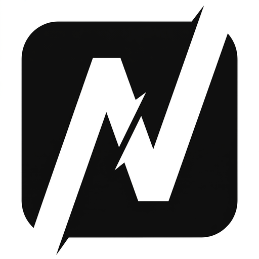
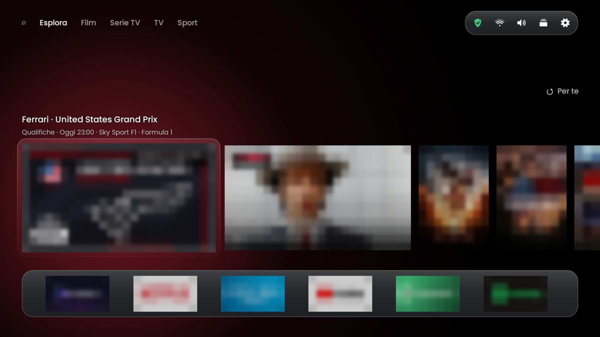
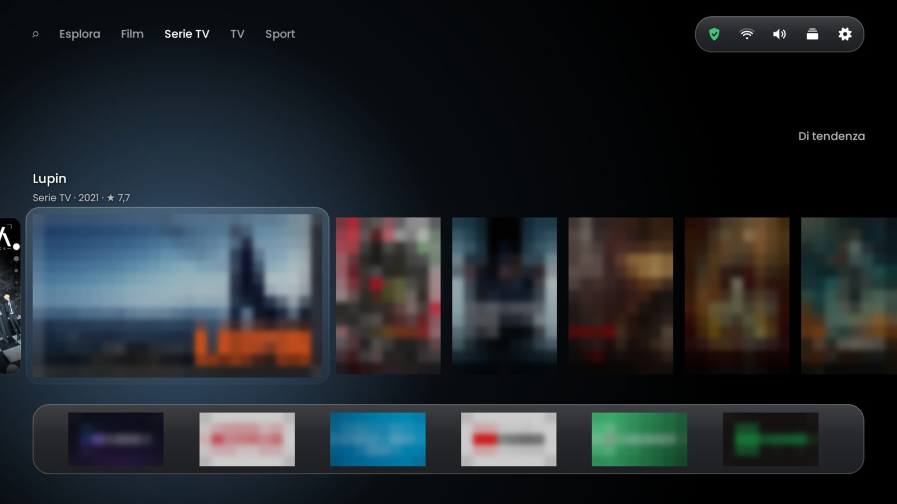
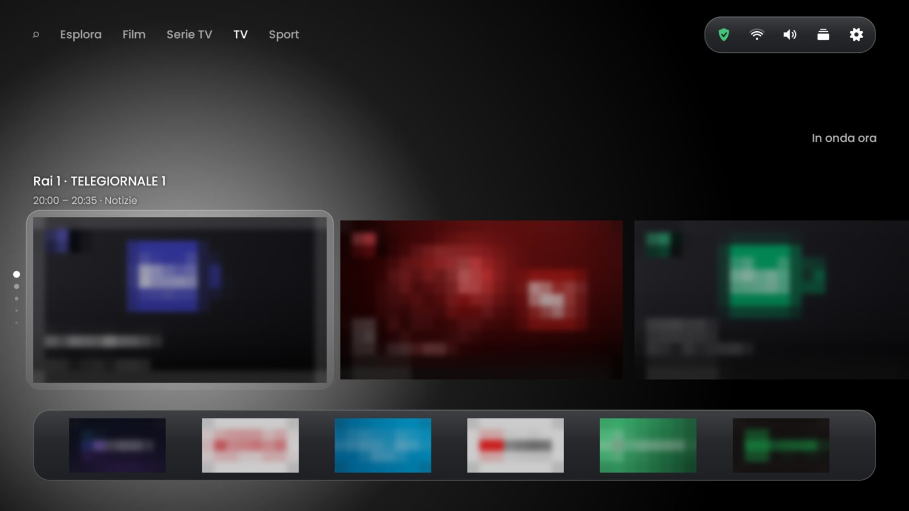
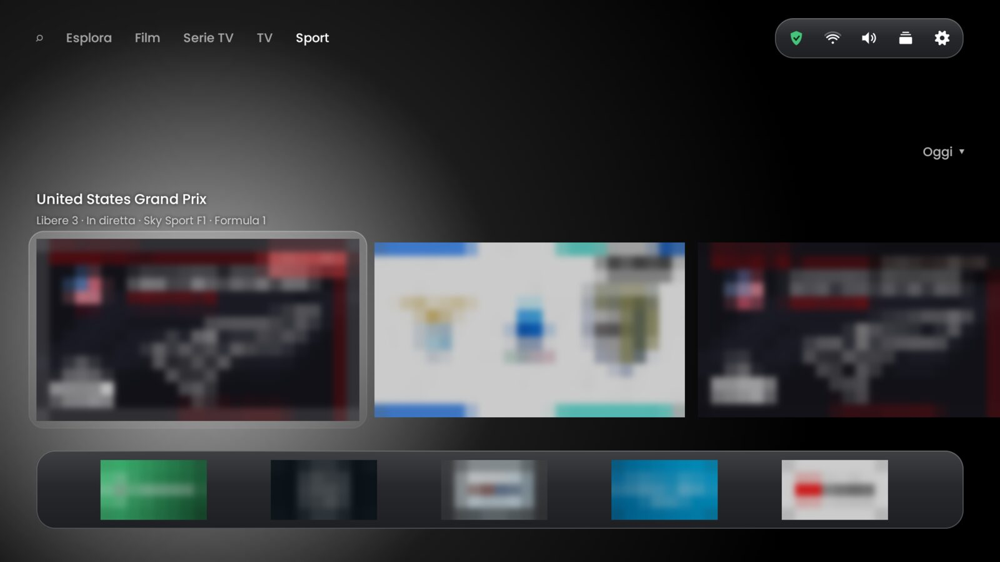
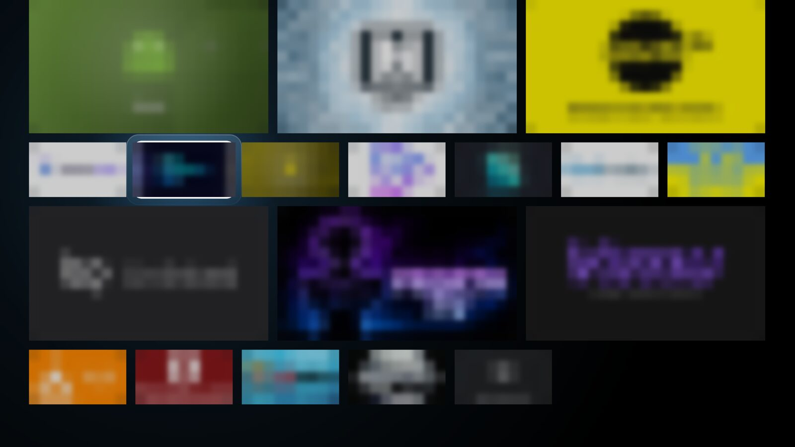
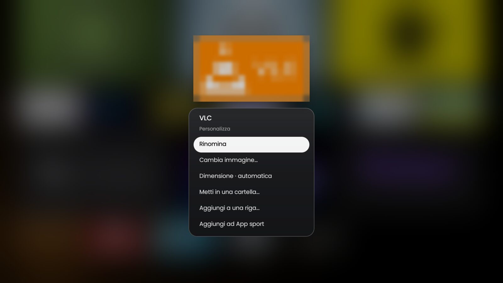
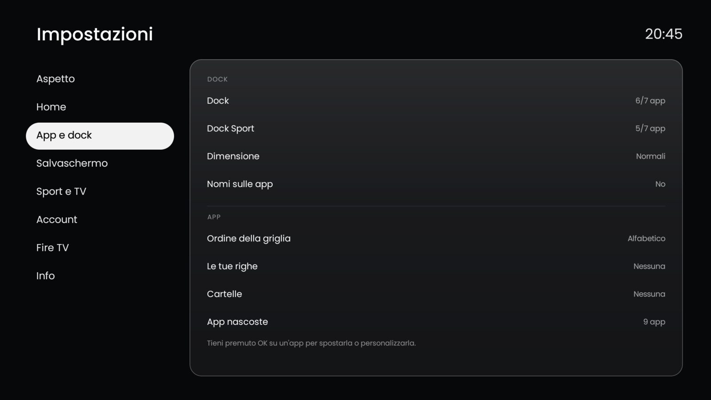

<p align="center">
  
</p>

<h1 align="center">Nello TV</h1>

<p align="center">
  A custom glass-style launcher for the Amazon Fire TV Stick.<br>
  <b>English</b> · <a href="README.it.md">Italiano</a>
</p>

## Screenshots

<p align="center"><i>Posters, channel artwork and other apps' logos are blurred: the pictures only show the launcher.</i></p>

| | |
|---|---|
|  |  |
| **Esplora** — *Per te* carousel and the dock, on the *Nero luminoso* background lit by the selected card | **Film / Serie TV** — one carousel per catalogue, dots on the left |
|  |  |
| **TV** — what's on now, with each channel's logo | **Sport** — today's matches and F1 sessions, the sport dock |
|  |  |
| **App grid** — large and small tiles, free order with *Sposta* | **Personalizza** — name, image (also found online), size, folder, rows |

<p align="center"><br><b>Impostazioni</b> — sections on the left, options on the right</p>

---

## Contents

1. [What it is](#what-it-is)
2. [Features](#features)
3. [Requirements](#requirements)
4. [Installing on a Fire TV](#installing-on-a-fire-tv)
5. [First-start setup](#first-start-setup)
6. [Using it](#using-it)
7. [Settings](#settings)
8. [Sport, Sportio and WireGuard](#sport-sportio-and-wireguard)
9. [Updates](#updates)
10. [Building from source](#building-from-source)
11. [Publishing a release](#publishing-a-release)
12. [Project structure](#project-structure)
13. [Troubleshooting](#troubleshooting)

---

## What it is

Nello TV replaces Amazon's home screen on a Fire TV Stick (tested on a Fire TV Stick 4K Max, Fire OS 8 / Android 11). It brings films, series, live TV and sport together in one place, in a frosted-glass style, and opens each thing in the app that plays it (Nuvio, Sportio, RaiPlay, Mediaset Infinity…).

It's a personal project: it doesn't play any content itself, it only shows what's available and opens the right app.

## Features

**Home and tabs**
- **Esplora** — "Per te" (suggestions from your Nuvio history, refreshed every night at 3:00, plus your team's matches, your F1 team's sessions and tonight's best film on Sky Cinema), *Continua a guardare* and an app grid.
- **Film / Serie TV** — TMDB catalogues (popular, in cinemas, upcoming, trending) and the Italian Top 10s by streaming service. Titles open in Nuvio.
- **TV** — Italian TV guide: *In onda ora*, *Stasera*, Sky Cinema and Sky entertainment channels. Rai opens RaiPlay, Mediaset opens Mediaset Infinity, Sky opens Sportio on the channel.
- **Sport** — today's matches (Serie A and Italian clubs in Europe), upcoming events, Formula 1, results; standings, your team's calendar, match pages.
- **Cerca** — search films, series and apps.

**Navigation**
- One large carousel per tab; **↑ / ↓** move between catalogues (dots on the left show where you are), **↑** on the first goes to the top menu, **↓** on the last goes to the dock. **Back** always returns to the top menu.
- A **dock** at the bottom that holds as many apps as fit across the screen (7 at normal size, 6 large, 8 small), with a separate one for the Sport tab.
- **Hold OK** on any app for a short menu: *Apri*, *Sposta* (move it anywhere in the dock or grid with the arrows: the tiles slide into place and the page follows), add to / remove from the dock, *Personalizza…*, *Nascondi*.
- **Personalizza…** — rename, change the image (a picture on the Fire TV, or alternatives found online on Google Play: HD icon, trailer cover, screenshots), size in the grid, folder, custom rows, sport apps.
- In every pop-up, **↑** with nothing above closes it and goes back to its button.

**Top-right menu**
- 🛡 **VPN** state and public IP · 📶 **network**, signal and ping · 🔊 **audio output** (TV or Bluetooth headphones, one press to switch) · ⚙ **settings**.

**Look**
- Frosted-glass UI over your wallpaper, a liquid selector pill, pop-ups that grow out of the button you pressed, **Poppins** typeface.
- **Always-on screensaver**: the wallpaper dims and a liquid-glass clock appears; it drifts slightly every minute to protect the screen.
- **Nero luminoso** (the default background): black, lit softly in the colour of whatever is selected, with a thin plate of lit glass around it.
- Other backgrounds: film or series of the day, Bing photo of the day, your own image or a folder in rotation, plain black.
- Apps without a horizontal banner get a cover drawn in the colour of their icon.
- Customisable: accent colour, glass intensity, interface size, visible tabs and catalogues, app names and images, night mode, navigation sounds.

**Smart extras**
- Reminders 10 minutes before your team's matches and your F1 team's sessions, over any app — press **OK** on the banner to watch.
- Sport and Sky channels open in **Sportio** on the right channel, found through the TV guide; optionally switching **WireGuard** on first and off again when you're back.
- Nello TV **updates itself** from this repository's releases.
- Disk cache for catalogues and images: the home opens instantly and works offline.

## Requirements

- An **Amazon Fire TV Stick** (Fire OS 7 or 8).
- Optional apps it works with: **Nuvio** (films, series, *Continua a guardare*), **Sportio** (sport and Sky channels), **WireGuard**, RaiPlay, Mediaset Infinity, DAZN, Netflix, Prime Video, YouTube.
- To install the APK: **LocalSend** or **Downloader** on the Fire TV, or a computer with `adb`.

## Installing on a Fire TV

### Option A — just the APK (no computer needed)

1. On the Fire TV: **Settings → My Fire TV → Developer options** → allow **apps from unknown sources** for LocalSend (or Downloader).
2. Send the APK (from the latest [release](../../releases)) with LocalSend, then open it and install.
3. Open **Nello TV** from the apps list — only this first time.
4. Follow the [first-start setup](#first-start-setup). From then on, the Home button leads to Nello TV.

### Option B — with a computer (`adb`)

1. On the Fire TV: **Settings → My Fire TV → Developer options → ADB debugging: on**, and note the IP address (**About → Network**).
2. From the project folder:
   ```sh
   ./install.sh 192.168.1.32
   ```
   It builds, installs and grants every permission in one go (background service, system settings, updates, WireGuard).

## First-start setup

On a new Fire TV, Nello TV opens with a short setup. Until you finish it, pressing Home brings you back to the step you left.

1. **Permessi** (permissions) — each with its state (✓ or *Da attivare*); press OK and the right system page opens:
   - **Servizio di Nello TV** (Accessibility): the Home button, the return after standby, the screensaver and the reminders.
   - **Aggiornamenti automatici**: lets Nello TV install new versions.
   - **Salvaschermo della Fire TV**: Nello TV's screensaver takes its place, so it must be on.
2. **La tua squadra** — a Serie A team (or none).
3. **Formula 1** — the team you follow (or none).
4. **Canali in Sportio** — choose your playlist number and press it: Sportio should play RAI 1. If it opens the channel list instead, press Home and try the next number.
5. **Nuvio** — sign in with a QR code, or skip.

You can run it again from **Impostazioni → Account → Configurazione iniziale**.

## Using it

| Where | Key | What happens |
|---|---|---|
| Top menu | ← → | change tab |
| Top menu | ↓ | into the tab |
| Carousel | ← → | move between titles (it wraps round) |
| Carousel | ↑ / ↓ | previous / next catalogue; past the first → top menu, past the last → dock |
| Anywhere | Back | top menu |
| App | hold OK or ☰ | app menu: open, move, dock, customise, hide |
| Match | hold OK or ☰ | match page (line-ups, events) |
| Pop-up | ↑ with nothing above | closes it and returns to its button |

## Settings

Open them from ⚙ → **Impostazioni del launcher**: a full screen with sections on the left and options on the right (the interface is in Italian; translations in brackets).

- **Aspetto** (look) — background, night mode, accent colour, glass, interface size, navigation sounds.
- **Home** — start tab, visible tabs and catalogues, card info, your team and F1 team, test reminder.
- **App e dock** — dock and sport dock, dock size and names, grid order, custom rows, folders, hidden apps.
- **Salvaschermo** (screensaver) — on/off, delay, widgets (match, F1, news and their sources), test.
- **Sport e TV** — Sportio playlist (picking one tests it), WireGuard for sport, VPN app.
- **Account** — Nuvio Sync, backup and restore, first-start setup.
- **Fire TV** — *Nello TV come home*, *Apri la home di Amazon*, shortcuts to the Fire TV settings.
- **Info** — Nello TV version and update check, Fire TV model, free storage and RAM.

## Sport, Sportio and WireGuard

- **Which channel** — for a match, Nello TV looks in the Italian TV guide for a programme named after the two teams around kick-off (Sky Sport, DAZN, Rai, TV8…). If the guide doesn't have it: Serie A → DAZN 1, European cups → Sky Sport Uno, Coppa Italia → Italia 1. F1 is always Sky Sport F1.
- **How it opens** — through Sportio's link `sportio://play/live?sourceId=<playlist>&name=<channel>`. The channel names must match your provider's ("Sky Sport Calcio", "DAZN 1"…).
- **WireGuard** — if enabled in Impostazioni → Sport e TV and WireGuard is installed, Nello TV switches the tunnel on before opening Sportio and off again when you return home (only if it was the one to switch it on). WireGuard needs **"Allow remote control apps"** turned on in its own settings. Use a separate tunnel profile per Fire TV: the same key on two devices at once makes both drop.

## Updates

Each release on this repository contains the APK. Nello TV checks for a newer one at start-up and in Impostazioni → Info → *Aggiornamenti*; one OK downloads and installs it.

The check compares the **build number** (the release tag, `v59`), so the version name can stay the same between releases.

## Building from source

1. Android SDK (compileSdk 34) and JDK 17.
2. Copy `local.properties.example` to `local.properties` and fill it in. **This file holds your keys and is never committed.**

   | Key | What it is |
   |---|---|
   | `sdk.dir` | path to the Android SDK |
   | `tmdb.key` | TMDB v3 API key (catalogues, images, logos) |
   | `topx.base` | your TopX addon configuration URL (Top 10s) |
   | `sports.base` | your sports addon configuration URL |
   | `nuvio.key` | Nuvio Sync public key |
   | `update.repo` | `owner/repository` for the updates |
   | `update.token` | fine-grained GitHub token, **read-only**, for that repository |
3. Build:
   ```sh
   ./gradlew assembleRelease
   ```
   The APK is in `app/build/outputs/apk/release/`.

## Publishing a release

```sh
./release.sh "what changed"
```

It commits any pending change, builds, pushes and creates a GitHub release with the APK, titled `Nello TV <version> · build <n>`. The version name is the single line in `version.properties` (e.g. `name=0.9.9`); change it when you want a new version name.

## Project structure

```
app/src/main/java/com/nello/tvhome/
  MainActivity.kt        home: tabs, carousels, dock, top-right menu
  Carousel.kt            the big carousel and its cards (media, match, F1, TV)
  GlassView.kt, GlassPopup.kt, GlassPage.kt   glass surfaces, pop-ups, pages
  FocusGroup.kt          the liquid selector pill
  SettingsActivity.kt    full-screen settings and the launcher's preferences
  OnboardingActivity.kt  first-start setup
  WakeService.kt         Home button, standby return, banners (accessibility service)
  Screensaver.kt         always-on screensaver and its liquid-glass clock
  Sources.kt             TMDB and TopX
  NuvioSync.kt           Nuvio Sync (Continua a guardare, history)
  Sport.kt, SportArt.kt, SportPagesActivity.kt   ESPN data, artwork, standings
  Sportio.kt, TvGuide.kt Sportio links, channels and the Italian TV guide
  Notifier.kt            reminders over other apps
  Updater.kt             self-update from GitHub releases
  Theme.kt, Fonts.kt     customisation and Poppins
```

## Troubleshooting

| Problem | Fix |
|---|---|
| Home opens Amazon's home | The Nello TV service is off: Fire TV Settings → Accessibility → Nello TV → on (or run the first-start setup). |
| A match opens Sportio's channel list instead of the channel | Wrong playlist number: Impostazioni → Sport e TV → *Playlist Sportio*, test with *Prova: apri RAI 1*. |
| WireGuard doesn't switch on | Turn on *Allow remote control apps* in WireGuard, and allow the permission Nello TV asks for. |
| No screensaver | Turn on the Fire TV screensaver (Fire TV Settings → Display & sounds) and the one in Nello TV (Impostazioni → Salvaschermo). |
| Updates don't install | Allow "apps from unknown sources" for Nello TV. |

---

<p align="center"><sub>Personal project · Poppins font under the SIL Open Font License · data from TMDB and ESPN</sub></p>
